# Лабораторная работа №1. Ansible: OpenSearch + Dashboards 3.8

**Задача:** написать Ansible-роль, которая ставит OpenSearch и OpenSearch Dashboards 3.8 в режиме single-node прямо на Linux-машину (без Docker), настраивает систему и сервисы, запускает их и сама применяет изменения конфигурации.

## Окружение

| Что | Значение |
|---|---|
| Управляющая машина | MacBook (Apple Silicon, arm64), macOS 26 |
| Ansible | ansible-core 2.19 в venv (`iac-labs/.venv`), ansible-lint |
| Целевая машина | VM Ubuntu 24.04 LTS (aarch64) в [Lima](https://lima-vm.io), 4 vCPU / 8 GB RAM / 30 GB диска |
| OpenSearch / Dashboards | 3.8.0 из официального apt-репозитория `artifacts.opensearch.org` |

Платить за сервер я не стала: преподаватель предложил поднять виртуалку локально, а 4/8 на ноутбуке с 24 ГБ помещаются без проблем. Lima запускает VM через встроенный в macOS Virtualization.framework и сама пробрасывает порты гостя на `127.0.0.1`. Поэтому API (9200) и Dashboards (5601) открываются прямо с хоста. Описание VM лежит в [lima-vm.yaml](lima-vm.yaml).

Роль не завязана на Lima: для удалённого сервера достаточно поменять хост в `inventory/hosts.yml`.

## Структура

```
lab1/
├── ansible.cfg
├── site.yml                      # плейбук: hosts opensearch -> роль opensearch
├── lima-vm.yaml                  # описание VM
├── inventory/
│   ├── hosts.yml
│   └── group_vars/opensearch.yml # значения параметров для моего стенда
└── roles/opensearch/
    ├── defaults/main.yml         # параметры роли со значениями по умолчанию
    ├── vars/main.yml             # внутренние константы (пути, имена пакетов, URL API)
    ├── meta/main.yml             # galaxy_info, платформы, dependencies: []
    ├── meta/argument_specs.yml   # типы параметров, Ansible проверяет их до старта
    ├── tasks/
    │   ├── main.yml              # порядок этапов
    │   ├── preflight.yml         # проверки ОС, архитектуры, пароля, версий
    │   ├── system.yml            # sysctl, swap
    │   ├── repository.yml        # ключ + apt-репозитории
    │   ├── opensearch.yml        # установка, hold, конфиги, systemd, автозапуск
    │   ├── dashboards.yml        # то же для Dashboards
    │   └── verify.yml            # проверка готовности через API с ретраями
    ├── handlers/main.yml         # apt update, sysctl, daemon-reload, рестарты
    ├── templates/                # все конфиги (Jinja2)
    │   ├── opensearch.yml.j2
    │   ├── heap.options.j2       # -> /etc/opensearch/jvm.options.d/
    │   ├── opensearch-override.conf.j2   # -> systemd drop-in
    │   ├── sysctl-opensearch.conf.j2
    │   ├── opensearch.sources.j2 # apt-репозитории в формате deb822
    │   └── opensearch_dashboards.yml.j2
    ├── files/opensearch-release.asc  # GPG-ключ репозитория
    └── tests/                    # test.yml: роль + проверка автозапуска и hold
```

Каждая директория роли что-то делает:

- **defaults** хранят всё, что пользователь может менять (список ниже);
- **vars** хранят то, что задано самими пакетами и меняться не должно: имена пакетов и пользователей, пути `/etc/opensearch` и `/usr/share/opensearch`, ветку репозитория (`3.8.0` → `3.x`), URL для проверок;
- **files** хранят GPG-ключ репозитория. Он лежит в роли, а не скачивается при каждом запуске: так меньше обращений к artifacts.opensearch.org, с которым у части группы были проблемы из российских датацентров, и ключ не подменить по дороге;
- **templates**: все шесть конфигов собираются через Jinja2;
- **handlers** перезапускают сервисы только при изменении (подробности ниже);
- **meta** описывает роль, а `argument_specs.yml` заставляет Ansible проверять типы параметров. Например, `opensearch_http_port: abc` упадёт сразу, а не на старте сервиса;
- **tests** содержат плейбук, который прогоняет роль и дополнительно проверяет, что оба сервиса работают и включены в автозапуск (`service_facts`) и что пакеты стоят на hold. Его можно запускать с управляющей машины или на самой целевой машине (`tests/inventory` = localhost). На моём стенде результат: `failed=0`, `changed=0`.

## Что делает роль

1. **Preflight.** Проверяет, что это Ubuntu/Debian на x86_64 или aarch64, что пароль admin проходит политику security plugin (≥ 8 символов, заглавные и строчные буквы, цифра, спецсимвол) и что версия Dashboards совпадает с OpenSearch.
2. **Система.** `vm.max_map_count=262144` (без него OpenSearch не стартует), `vm.swappiness=1`, отключает swap сейчас и в `/etc/fstab`. Чтобы sysctl применился до первого старта, в конце этапа стоит `meta: flush_handlers`.
3. **Репозиторий.** Ставит зависимости, кладёт ключ и файл `/etc/apt/sources.list.d/opensearch.sources`. `apt update` выполняется handler'ом, только если файл изменился.
4. **OpenSearch.** `apt install opensearch=3.8.0` и `apt-mark hold`. Затем шаблоны `opensearch.yml` и `jvm.options.d/heap.options`, systemd drop-in с `LimitNOFILE`, `LimitMEMLOCK=infinity` (для `bootstrap.memory_lock`) и увеличенным `TimeoutStartSec`. В конце `enabled: true` + `state: started`.
5. **Dashboards.** То же самое: пакет нужной версии, hold, шаблон `opensearch_dashboards.yml`, автозапуск.
6. **Проверка.** `GET _cluster/health` через модуль `uri` с `until`/`retries`/`delay`: роль ждёт статус из `opensearch_healthcheck_statuses`, но не больше 30 × 10 секунд. Затем проверяет, что `GET /` отдаёт именно `3.8.0`, и ждёт `GET /api/status` у Dashboards в состоянии `green`.

### Handlers и лишние рестарты

- Конфиги OpenSearch (`opensearch.yml`, heap, systemd override) и смена версии пакета вызывают `Перезапустить OpenSearch`. Конфиг Dashboards вызывает только `Перезапустить OpenSearch Dashboards`.
- Изменение systemd override вызывает ещё и `daemon-reload`. Handlers выполняются в порядке файла, поэтому reload успевает раньше рестарта.
- При первом прогоне сервис сначала запускается задачей `state: started`, и handler рестарта после этого бессмысленен. Поэтому у handler'а стоит условие `when: opensearch_service_start is not changed`: если сервис только что стартовал, второй раз его не перезапускают.
- Перед проверкой стоит `flush_handlers`, чтобы проверялось уже перезапущенное состояние.

### Автозапуск после перезагрузки

Это `systemctl enable` для обоих сервисов, плюс sysctl в `/etc/sysctl.d/` и swap, закомментированный в fstab: после ребута всё нужное OpenSearch применяется без Ansible. Я проверила это перезагрузкой VM (скриншот ниже).

## Параметры роли

Все параметры лежат в [defaults/main.yml](roles/opensearch/defaults/main.yml). Принцип выбора: в defaults я вынесла то, что реально отличается от стенда к стенду (версии, адреса, порты, память, безопасность, пути к данным, зеркало). Всё, что диктует пакет, остаётся в vars.

| Параметр | По умолчанию | Зачем |
|---|---|---|
| `opensearch_version` | `3.8.0` | Точная версия. В репозитории `3.x` уже лежит 3.9.0, так что без пина поставилась бы она |
| `opensearch_dashboards_version` | `= opensearch_version` | Dashboards работает только с той же версией OpenSearch, preflight это проверяет |
| `opensearch_dashboards_enabled` | `true` | Можно поставить только сам OpenSearch |
| `opensearch_repo_url` | `https://artifacts.opensearch.org/releases/bundle` | Можно подставить своё зеркало, если с сервера не открывается официальный репозиторий |
| `opensearch_cluster_name` | `lab-cluster` | Имя кластера видно в `_cluster/health`, у разных стендов оно должно различаться |
| `opensearch_node_name` | короткое имя хоста из inventory | Узнаваемое имя узла вместо случайного |
| `opensearch_network_host` | `0.0.0.0` | API доступен снаружи VM. Для закрытого узла можно поставить `127.0.0.1` |
| `opensearch_http_port` / `opensearch_transport_port` | `9200` / `9300` | Стандартные порты, их можно поменять при конфликте |
| `opensearch_data_path` / `opensearch_logs_path` | `/var/lib/opensearch` / `/var/log/opensearch` | Данные часто выносят на отдельный диск |
| `opensearch_heap_size` | половина RAM, но ≤ 31 ГБ | Официальная рекомендация. Выше ~31 ГБ JVM теряет compressed oops |
| `opensearch_memory_lock` | `true` | Heap не уходит в swap (`bootstrap.memory_lock` + `LimitMEMLOCK`) |
| `opensearch_vm_max_map_count` | `262144` | Минимум, который требует OpenSearch |
| `opensearch_nofile_limit` | `65535` | Лимит открытых файлов для сервиса |
| `opensearch_disable_swap` | `true` | Рекомендация OpenSearch. На машине, где swap нужен другим сервисам, можно выключить |
| `opensearch_security_enabled` | `true` | Security plugin: TLS на 9200 и логин/пароль. Без него любой, кто достучится до 9200, может всё |
| `opensearch_admin_password` | `""` (обязателен) | Пароль admin. Пустое значение по умолчанию сделано специально: роль не стартует без явно заданного пароля |
| `opensearch_dashboards_server_password` | `kibanaserver` | Пароль служебного пользователя Dashboards из демо-конфигурации |
| `opensearch_healthcheck_retries` / `_delay` | `30` / `10` | До 5 минут ожидания: первый старт с инициализацией security-индекса долгий |
| `opensearch_healthcheck_statuses` | `[green, yellow]` | На одном узле реплики разместить негде, поэтому yellow тоже считается нормой |
| `opensearch_dashboards_host` / `_port` | `0.0.0.0` / `5601` | Адрес и порт веб-интерфейса |
| `opensearch_extra_config` / `opensearch_dashboards_extra_config` | `{}` | Любые дополнительные настройки, которые дописываются в конфиг без правки шаблона |

На моём стенде в [group_vars](inventory/group_vars/opensearch.yml) переопределены только имя кластера (`devops-lab1`) и heap (`2g`). Пароль в репозитории не хранится: он читается из переменной окружения `OPENSEARCH_ADMIN_PASSWORD`.

## Запуск

```bash
# 1. VM (один раз)
limactl start --name=opensearch-lab lab1/lima-vm.yaml

# 2. Ansible
python3 -m venv .venv && .venv/bin/pip install 'ansible-core<2.20' ansible-lint

# 3. Роль
cd lab1
export OPENSEARCH_ADMIN_PASSWORD='<пароль>'
../.venv/bin/ansible-playbook site.yml
```

Полезные варианты:

```bash
../.venv/bin/ansible-playbook site.yml --tags verify          # только проверка готовности
../.venv/bin/ansible-playbook site.yml -e opensearch_heap_size=1g   # поменять параметр без правки файлов
../.venv/bin/ansible-lint site.yml                              # линтер (профиль production проходит)
../.venv/bin/ansible-playbook -i inventory/hosts.yml roles/opensearch/tests/test.yml  # роль + проверка автозапуска и hold
```

## Результаты

### Создание VM

Чтобы снять установку с нуля, я пересоздала VM: `limactl delete` + `limactl start`.

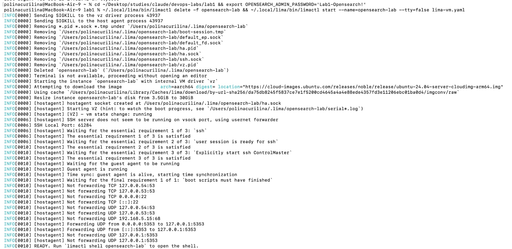

### Первый прогон

Всё установилось с нуля: ключ, репозитории, пакеты 3.8.0 на hold, конфиги из шаблонов. Handlers `Применить sysctl` и `Обновить кэш apt` сработали сразу, прямо посреди прогона, благодаря `flush_handlers`.

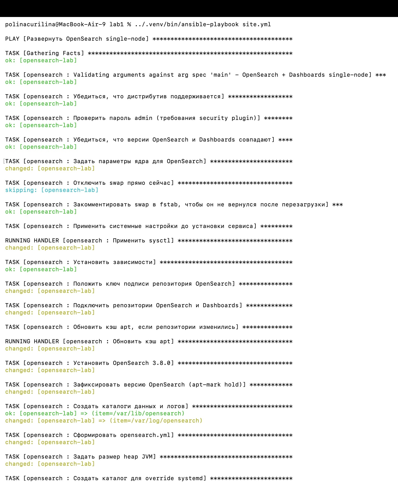

В конце оба handler'а рестарта `skipping`: сервисы только что стартовали, и перезапускать их незачем. Проверка через API дождалась `"status": "green"`. Dashboards ответил со второй попытки (`FAILED - RETRYING` — это retry, а не ошибка). Итог: `failed=0`.

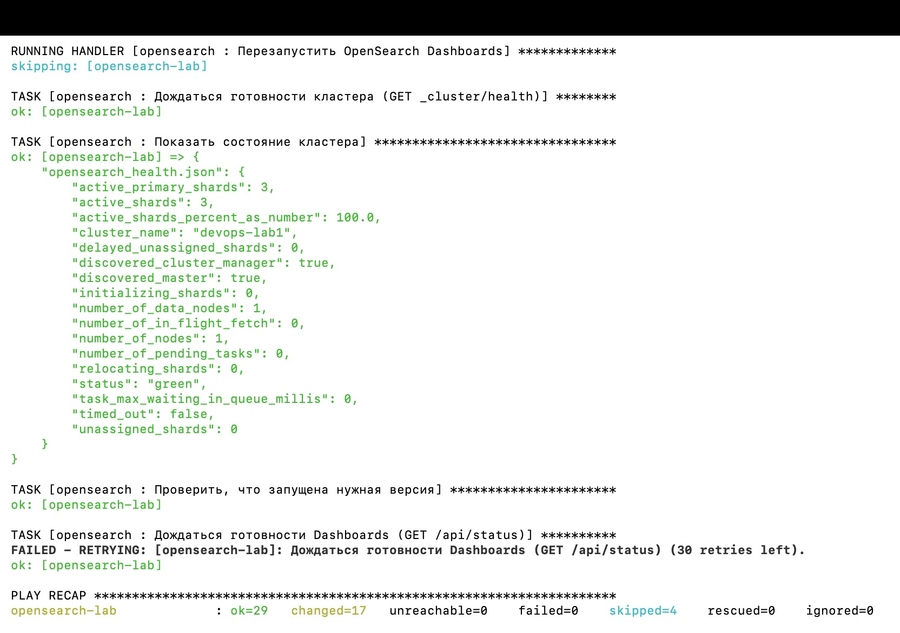

### Повторный прогон: идемпотентность

Все задачи `ok`, ничего не меняется: роль не трогает то, что уже в нужном состоянии.

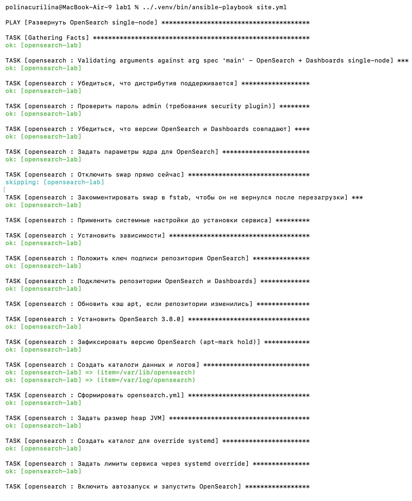

Конец того же прогона: ни одного `RUNNING HANDLER`, сервисы не перезапускались, итог `changed=0`. Шардов теперь 8, а не 5: Dashboards успел создать свои системные индексы.

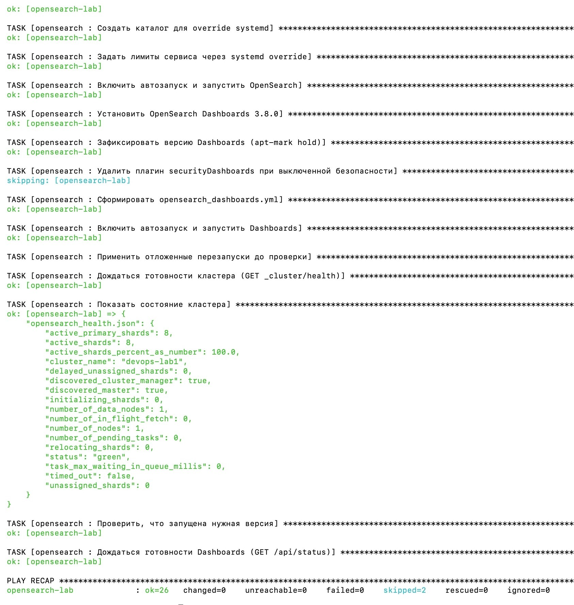

### Изменение параметра → handler

`-e opensearch_heap_size=1g`: из всех задач изменилась только `Задать размер heap JVM`.

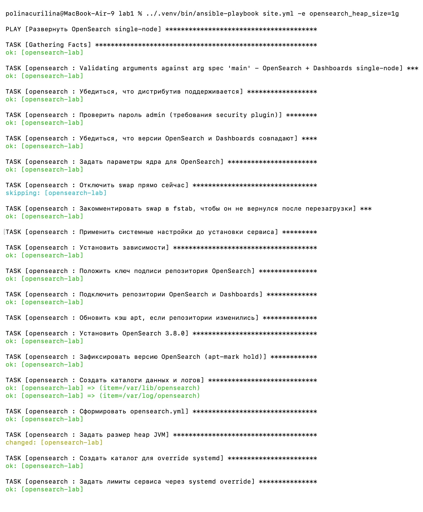

После неё handler перезапустил OpenSearch, поэтому проверка готовности один раз сделала retry, пока узел поднимался. Итог: `changed=2` (шаблон heap + рестарт OpenSearch). Dashboards не перезапускался. Ниже на скриншоте видно начало следующего обычного прогона, который вернул heap на 2g из `group_vars`.

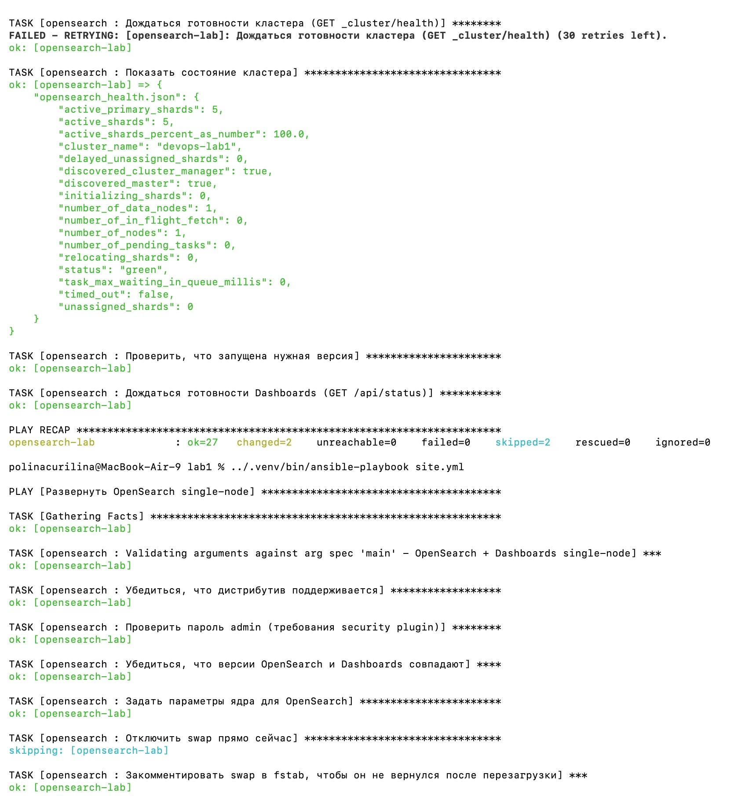

Сам запуск handler'а крупно: `RUNNING HANDLER [Перезапустить OpenSearch]` → `changed`. Сразу после рестарта узел ещё поднимается, поэтому `_cluster/health` один раз делает retry, а дальше снова `green`.

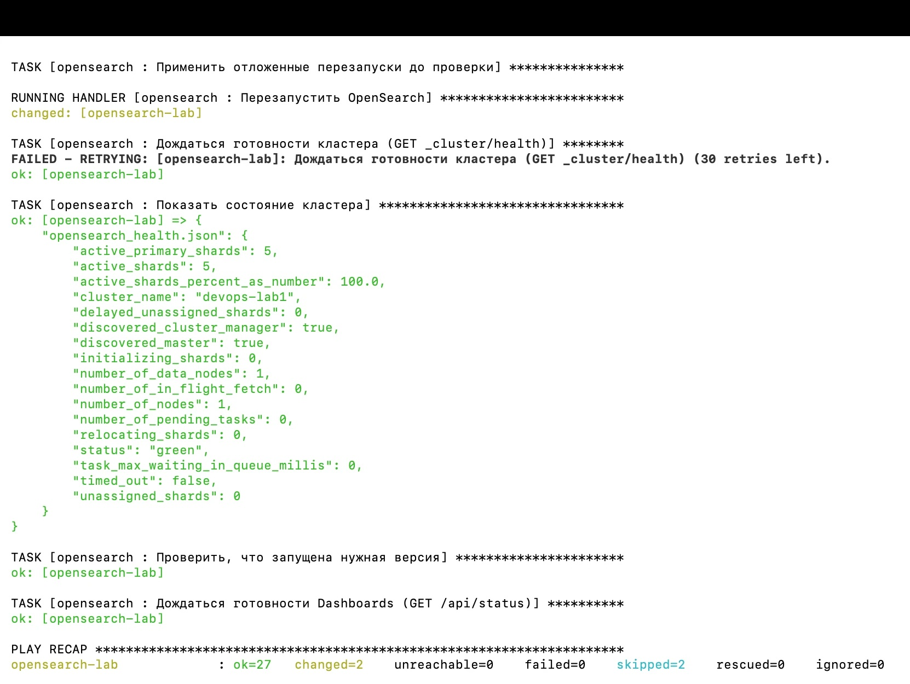

### GET _cluster/health

```bash
curl -sk -u admin:"$OPENSEARCH_ADMIN_PASSWORD" "https://127.0.0.1:9200/_cluster/health?pretty"
```

```json
{
  "cluster_name" : "devops-lab1",
  "status" : "green",
  "timed_out" : false,
  "number_of_nodes" : 1,
  "number_of_data_nodes" : 1,
  "discovered_master" : true,
  "discovered_cluster_manager" : true,
  "active_primary_shards" : 5,
  "active_shards" : 5,
  "relocating_shards" : 0,
  "initializing_shards" : 0,
  "unassigned_shards" : 0,
  "delayed_unassigned_shards" : 0,
  "number_of_pending_tasks" : 0,
  "number_of_in_flight_fetch" : 0,
  "task_max_waiting_in_queue_millis" : 0,
  "active_shards_percent_as_number" : 100.0
}
```

Тот же запрос и `GET _nodes`: версия 3.8.0, `mlockall: true`, heap 2 ГБ (`2147483648`) после возврата значения из `group_vars`, все плагины 3.8.0.

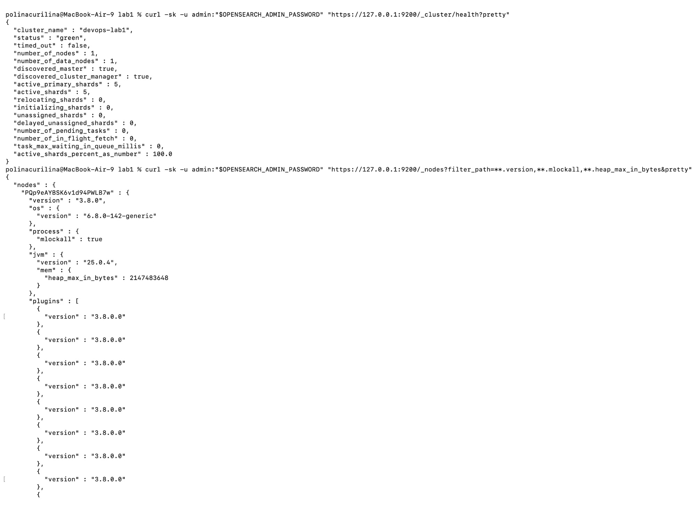

### После перезагрузки VM

`limactl stop` + `limactl start`: после старта Lima сама пробросила 9200 и 5601 на хост. Оба сервиса `active`, хотя Ansible я не запускала.

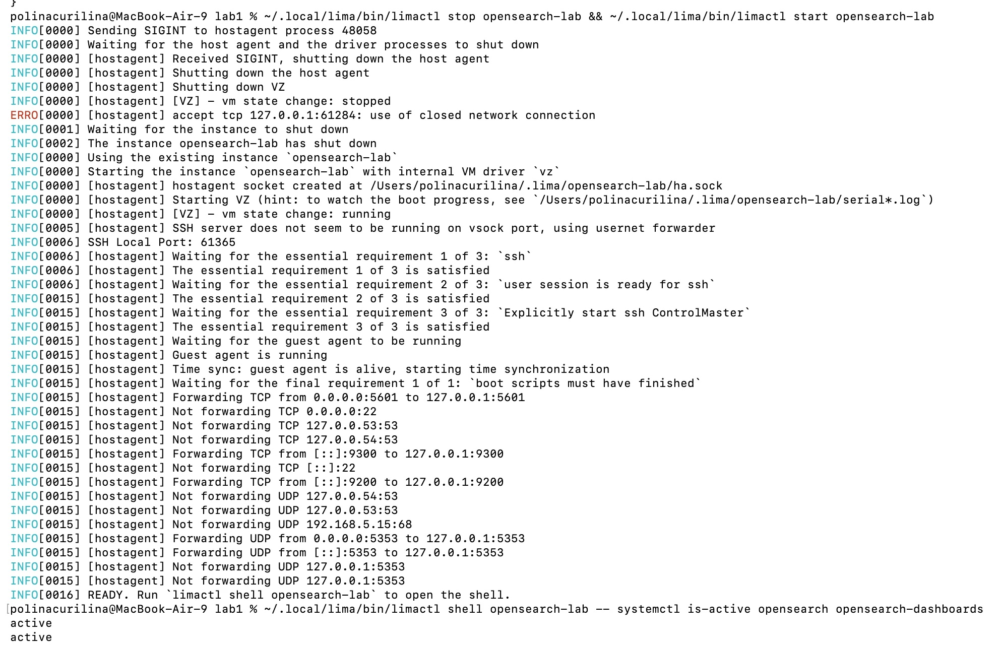

Кластер снова `green`:

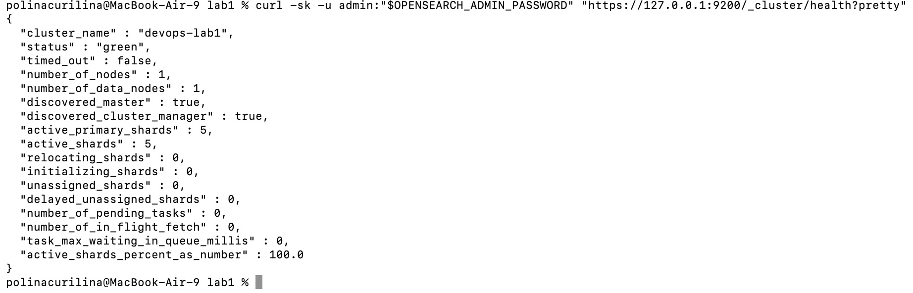

### OpenSearch Dashboards

`http://127.0.0.1:5601`, вход под `admin` (аватар `a` справа вверху).

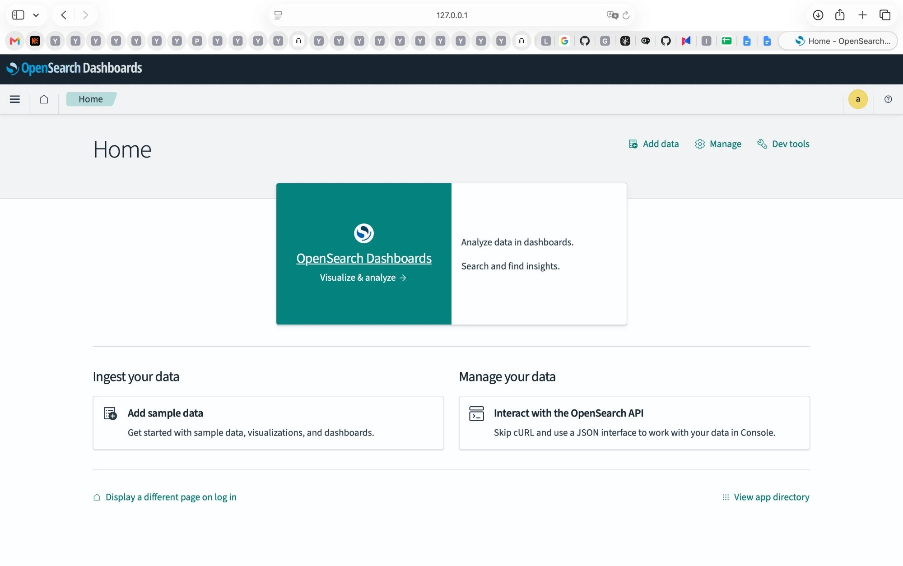

## Грабли

**Грабля 1: «последняя версия» уже не 3.8.** В apt-репозитории `3.x` лежат все версии до 3.9.0. Обычный `apt install opensearch` поставил бы 3.9, а `apt upgrade` когда-нибудь тихо обновил бы кластер. Поэтому роль ставит `opensearch=3.8.0` и вешает `apt-mark hold`. А чтобы версию всё-таки можно было сменить через переменную, в задаче `apt` включён `allow_change_held_packages`.

**Грабля 2: шаблон затирает демо-конфигурацию безопасности.** Начиная с 2.12 deb-пакет при установке с `OPENSEARCH_INITIAL_ADMIN_PASSWORD` генерирует демо-сертификаты и *дописывает* настройки `plugins.security.*` в `opensearch.yml`. Мой шаблон перезаписывает файл целиком, и после первого же прогона OpenSearch остался бы без TLS-настроек. Решение: эти настройки перенесены в шаблон под ``, а сертификаты остаются те, что сгенерировал пакет. (Это видно в `/var/lib/dpkg/info/opensearch.postinst` и в логе `/var/log/opensearch/install_demo_configuration.log`.) Там же нашлись флаги `DISABLE_INSTALL_DEMO_CONFIG` и `DISABLE_SECURITY_PLUGIN`, которые появились в 3.7. Роль передаёт их при `opensearch_security_enabled: false`.

**Грабля 3: двойной рестарт на первом прогоне.** Установка пакета и шаблоны вызывают handler рестарта, но сервис только что запустила задача `state: started`. Без условия первый прогон заканчивался бы лишним рестартом сразу после запуска. Отсюда `when: ... is not changed` в handlers.

**Грабля 4: sysctl в handler'е, а он нужен сразу.** Handlers выполняются в конце play, а `vm.max_map_count` нужен до первого старта OpenSearch. Помог `meta: flush_handlers` в конце `system.yml`. Та же история с `apt update` после добавления репозитория.

**Грабля 5: порт SSH у Lima каждый раз новый.** После перезагрузки VM Ansible перестал подключаться: порт поменялся с 60440 на 60534. В inventory теперь не порт, а `-F ~/.lima/opensearch-lab/ssh.config`, который Lima обновляет сама.

## Выводы

- Роль ставит OpenSearch и Dashboards 3.8.0 на «голую» Ubuntu одной командой и доводит кластер до `green`.
- Она идемпотентна: повторный прогон даёт `changed=0`. Рестарт происходит только при реальном изменении и только у того сервиса, который изменился.
- Всё переживает перезагрузку без Ansible.
- Параметры вынесены в defaults и проверяются через `argument_specs`, пароль не хранится в коде.

Не проверяла: ветку `opensearch_security_enabled: false`. Она рассчитана на установку с нуля. Переключить уже работающий узел из security в plain HTTP и обратно роль не умеет, потому что плагин Dashboards при выключении удаляется.

## Про инструменты

- **Ansible**: декларативно описываешь, *каким* должен быть сервер, а не *что* на нём выполнить. Самое полезное в этой лабе: handlers + `notify` (рестарт только при изменении) и `until`/`retries` (вместо `sleep 60` и надежды).
- **OpenSearch**: форк Elasticsearch 7.10 от AWS под лицензией Apache 2.0. Поисковый движок и хранилище логов, Dashboards — его веб-интерфейс (аналог Kibana).
- **Lima**: Linux-VM на macOS одной командой, с пробросом портов и готовым SSH-конфигом.
