# Лабораторная работа №2. Тестирование с Molecule

**Задача:** расширить роль `opensearch` из [первой лабы](../lab1/) настройкой безопасности через Security REST API и покрыть её автоматическими тестами в Molecule.

## Окружение

| Что | Значение |
|---|---|
| Управляющая машина | MacBook (Apple Silicon, arm64), macOS 26 |
| Инструменты | ansible-core 2.19, molecule 26.11, ansible-lint 26.10 в venv (`iac-labs/.venv`) |
| Целевая машина | VM Ubuntu 24.04 LTS (aarch64) в [Lima](https://lima-vm.io), 4 vCPU / 8 GB RAM / 30 GB диска |
| OpenSearch / Dashboards | 3.8.0, та же установка из apt, что и в первой лабе |

Первая лаба уже сдана, поэтому её я не меняла: роль скопирована в `lab2/roles/opensearch` и расширена здесь.

Molecule обычно поднимает Docker-контейнеры, но в этой роли они не подходят: роль настраивает ядро (`vm.max_map_count`), `memory_lock` и systemd и ставит OpenSearch прямо на машину. Поэтому я взяла драйвер `default`: Molecule вызывает мои `create.yml` и `destroy.yml`, а те создают и удаляют настоящую VM через `limactl`.

## Что добавилось в роль

```
lab2/
├── ansible.cfg
├── site.yml                        # обычный запуск роли без Molecule
├── lima-vm.yaml                    # описание VM
├── inventory/
│   ├── hosts.yml
│   └── group_vars/opensearch/
│       ├── main.yml                # параметры стенда
│       └── vault.yml               # пароли, зашифровано Ansible Vault
└── roles/opensearch/
    ├── tasks/
    │   ├── data_stream.yml         # новое: шаблон индекса и data stream logs
    │   └── security.yml            # новое: роли, пользователи, role mapping
    └── molecule/default/           # новое: сценарий Molecule
        ├── molecule.yml            # последовательность шагов и настройки
        ├── create.yml, destroy.yml # VM через Lima
        ├── converge.yml            # запуск роли
        ├── side_effect.yml         # перезагрузка VM перед проверками
        ├── verify.yml              # подключает тестовые сценарии
        └── tests/scenario_{0..3}_*.yml
```

## Часть 1. Ролевая модель

Все объекты создаются через API от имени `admin`, после проверки готовности кластера.

| Роль | Пользователь | Кластерные права | Права на индексы |
|---|---|---|---|
| `logs_writer` | `logs_writer_user` | `indices:data/write/bulk` | `logs`: `indices:data/write/index`, `indices:data/write/bulk*` |
| `logs_reader` | `logs_reader_user` | нет | `logs*`: `read` |
| `cluster_admin` | `cluster_admin_user` | `cluster_monitor`, `cluster:admin/settings/update` | нет |

**Почему у роли записи есть кластерное право.** `indices:data/write/bulk` здесь обязательно: без него плагин безопасности отклоняет даже запись одного документа (ответ 403). Читать данные и управлять кластером оно не позволяет, и сценарий 1 это проверяет.

**Шаблон индекса** `logs` задаёт для data stream `logs` поле времени `@timestamp`, 0 реплик (на одном узле их негде разместить) и заранее описанные поля `@timestamp`, `message`, `level`. Настройка `dynamic: false` означает, что новые поля сохраняются в документе, но не меняют маппинг. Так роли записи не нужно право администрирования индекса `indices:admin/mapping/put`.

### Новые параметры роли

| Параметр | По умолчанию | Зачем |
|---|---|---|
| `opensearch_logs_data_stream` | `logs` | Имя data stream из задания, вынесено, чтобы не дублировать его в роли и шаблоне |
| `opensearch_logs_template_name` | `logs` | Имя шаблона индекса |
| `opensearch_logs_template_priority` | `200` | Выше встроенных шаблонов, чтобы при совпадении паттернов применялся этот |
| `opensearch_logs_template_replicas` | `"0"` | На одном узле с одной репликой кластер был бы `yellow`. На нескольких узлах значение стоит увеличить |
| `opensearch_logs_template_mappings` | поля выше, `dynamic: false` | Набор полей зависит от приложения, поэтому меняется без правки задач |
| `opensearch_security_roles` | три роли выше | Модель прав можно менять без правки задач |
| `opensearch_security_users` | три пользователя выше | Имя, пароль и роль каждого пользователя |
| `opensearch_logs_writer_password`, `opensearch_logs_reader_password`, `opensearch_cluster_admin_password` | `""` (обязательны) | Значений по умолчанию нет намеренно: без явно заданного пароля роль останавливается на preflight-проверке |

Параметры из первой лабы описаны в [её отчёте](../lab1/README.md#параметры-роли).

### Пароли

Пароли лежат в [vault.yml](inventory/group_vars/opensearch/vault.yml), он зашифрован Ansible Vault. Ключ `.vault_pass` в репозиторий не попадает (`.gitignore`). Задачи, которые передают пароли, отмечены `no_log: true`. Я проверила лог полного прогона: ни одного из четырёх паролей в нём нет.

Чтобы запустить роль без моего ключа, нужно создать свой:

```bash
openssl rand -base64 32 > .vault_pass
rm inventory/group_vars/opensearch/vault.yml
../.venv/bin/ansible-vault create inventory/group_vars/opensearch/vault.yml
```

В файле нужны четыре переменные: `vault_opensearch_admin_password`, `vault_opensearch_logs_writer_password`, `vault_opensearch_logs_reader_password`, `vault_opensearch_cluster_admin_password`. Пароль должен быть не короче 8 символов, с заглавной и строчной буквой, цифрой и спецсимволом.

### Идемпотентность

Security API принимает `PUT` всегда, поэтому без дополнительных проверок повторный прогон менял бы всё заново. Роль сначала читает текущее состояние и выполняет `PUT` только при расхождении. Хеш пароля сравнить нельзя, поэтому пароль проверяется входом под этим пользователем: ответ 401 означает, что пользователя нет или пароль другой, и только тогда пользователь записывается заново.

## Часть 2. Автотесты

Последовательность шагов `molecule test`:

| Шаг | Что происходит |
|---|---|
| `destroy` | Удаляет VM, оставшуюся от прошлых запусков |
| `syntax` | Проверяет синтаксис плейбука |
| `create` | Создаёт новую VM через Lima |
| `converge` | Запускает роль |
| `idempotence` | Запускает роль повторно, любое изменение считается ошибкой |
| `side_effect` | Перезагружает VM |
| `verify` | Выполняет сценарии 0–3 |
| `destroy` | Удаляет VM |

### Сценарий 0. Сервис действительно работает

Проверки идут после перезагрузки, поэтому заодно подтверждают автозапуск.

| Проверка | Что подтверждает |
|---|---|
| Оба сервиса `active` и `enabled` | Автозапуск работает |
| `vm.max_map_count ≥ 262144`, пакеты на hold | Настройки системы пережили перезагрузку |
| Запрос без пароля и с неверным паролем получает 401 | Авторизация действительно включена |
| `_cluster/health`: `green`, нужное имя кластера, 1 узел, 0 неразмещённых шардов | Кластер здоров и настроен как задано |
| Версия 3.8.0, `mlockall: true`, heap 2 ГБ, есть плагин `opensearch-security` | Параметры роли применились |
| Документ записывается и находится поиском, затем индекс удаляется | Кластер реально принимает и отдаёт данные |
| Data stream в статусе `GREEN` и создан из шаблона `logs` | Часть 1 выполнена и пережила перезагрузку |
| Dashboards: `/api/status` в состоянии `green` | Веб-интерфейс работает и видит кластер |

### Сценарии 1–3. Права пользователей

| Сценарий | Действие | Ожидание |
|---|---|---|
| 1. Запись | Записать документ в `logs` | 201, документ попал в `.ds-logs-*` |
| | Поиск и чтение документа по id | 403 |
| | Запись в `logs-other` и в индекс вне `logs*` | 403 |
| | `_cluster/health`, `_cluster/settings`, `GET /` | 403 |
| | Удалить data stream | 403 |
| 2. Чтение | Поиск в `logs*` | Находит именно документ из сценария 1 (тот же `_id`) |
| | Запись в `logs` и `logs-other` | 403 |
| | Удалить `logs`, backing-индекс и data stream | 403 |
| | Чтение индекса вне `logs*` | 403 |
| 3. Администратор | `_cluster/settings`, `_cluster/health` | 200, кластер `green` |
| | Версия OpenSearch | 3.8.0 |
| | Изменить и вернуть настройку кластера | 200 |
| | Поиск в `logs*`, в backing-индексе и индексе вне `logs*` | 403 |
| | Запись в `logs` | 403 |
| | Security API | 403 |

### Проверка самих тестов

Тест, который никогда не падает, ничего не доказывает. Поэтому на работающей VM я через API выдала роли `logs_writer` право `read` и запустила `molecule verify`. Сценарий 1 упал на проверке «поиск запрещён» (`Status code was 200 and not [403]`). Следующий прогон роли вернул права обратно (`changed=1`), а ещё один дал `changed=0`.

## Запуск

Molecule и `limactl` должны быть в `PATH`:

```bash
cd lab2/roles/opensearch
source ../../../.venv/bin/activate
export PATH="$PATH:$HOME/.local/lima/bin"
molecule test
```

Другие варианты:

```bash
molecule test --destroy never   # оставить VM после прогона
molecule verify                 # повторить только сценарии 0-3 на той же VM
molecule destroy                # удалить VM
```

Обычный запуск роли и линтер (из `lab2/`, VM уже должна существовать):

```bash
../.venv/bin/ansible-playbook site.yml
../.venv/bin/ansible-lint site.yml roles/opensearch
```

## Результаты

Скриншоты и вывод сняты с одного полного прогона `molecule test` на новой VM.

### Подготовка и запуск

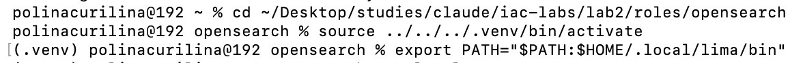

Шаги `destroy` и `syntax`, начало `create`:

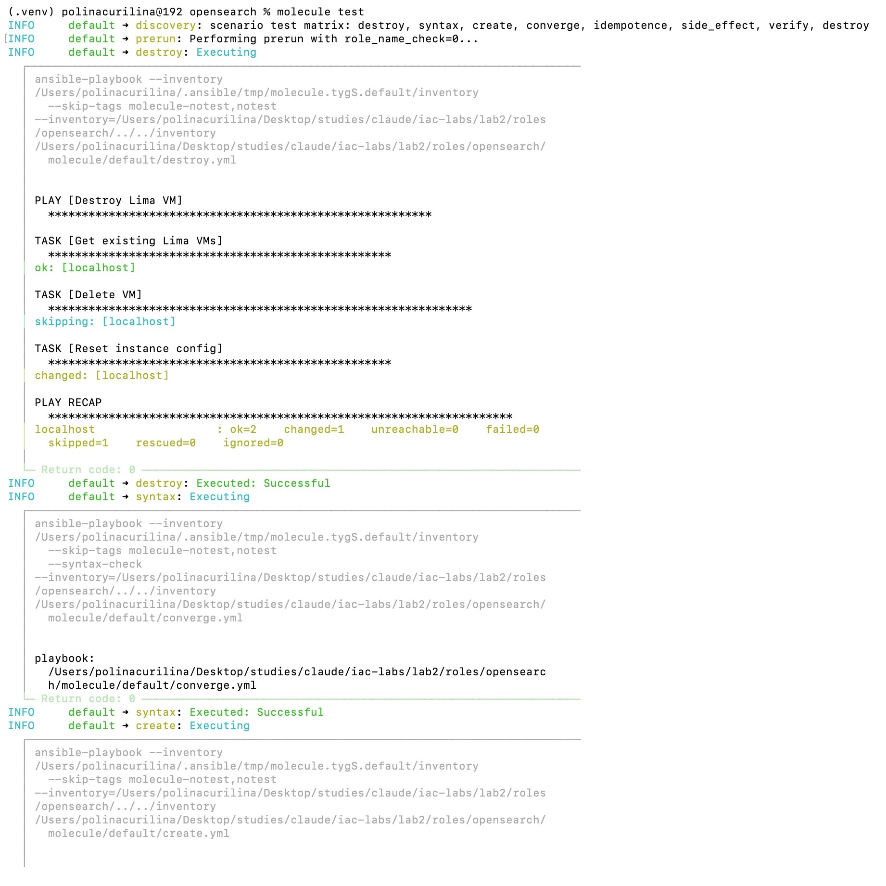

### Create и начало converge

VM создана, роль начала работу с проверок параметров.

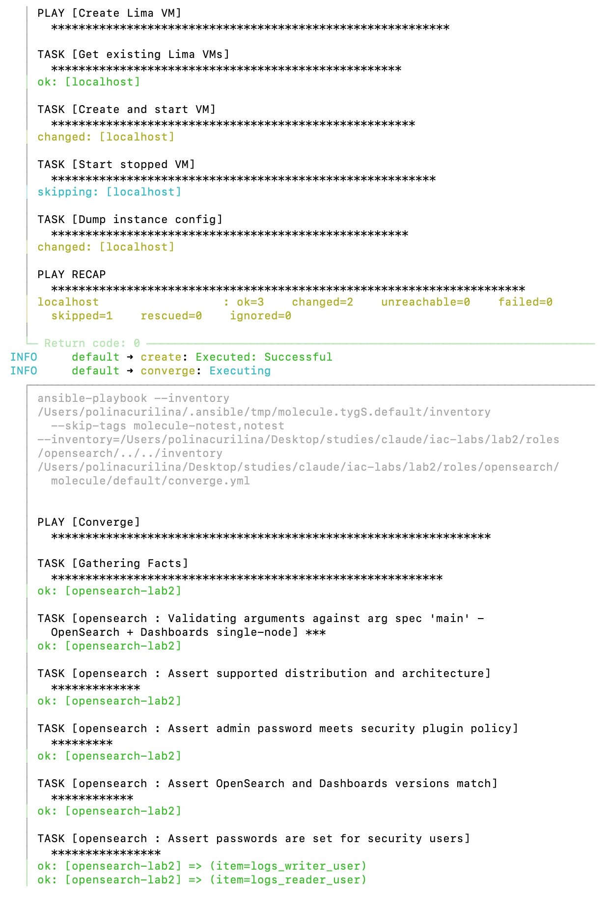

### Converge: установка

Настройка системы и установка OpenSearch 3.8.0. Handlers `Apply sysctl` и `Update apt cache` срабатывают сразу, чтобы настройки применились до следующих задач.

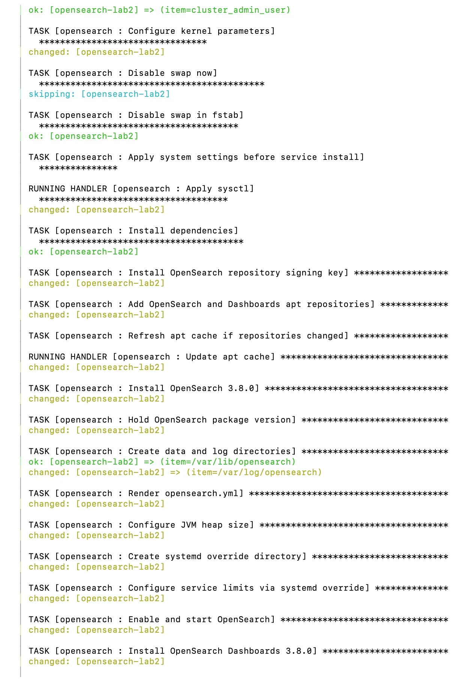

Установка Dashboards и проверка готовности через API. Handlers рестарта `skipping`: сервисы только что запущены. `FAILED - RETRYING` у Dashboards означает повторную попытку, пока сервис стартует, а не ошибку.

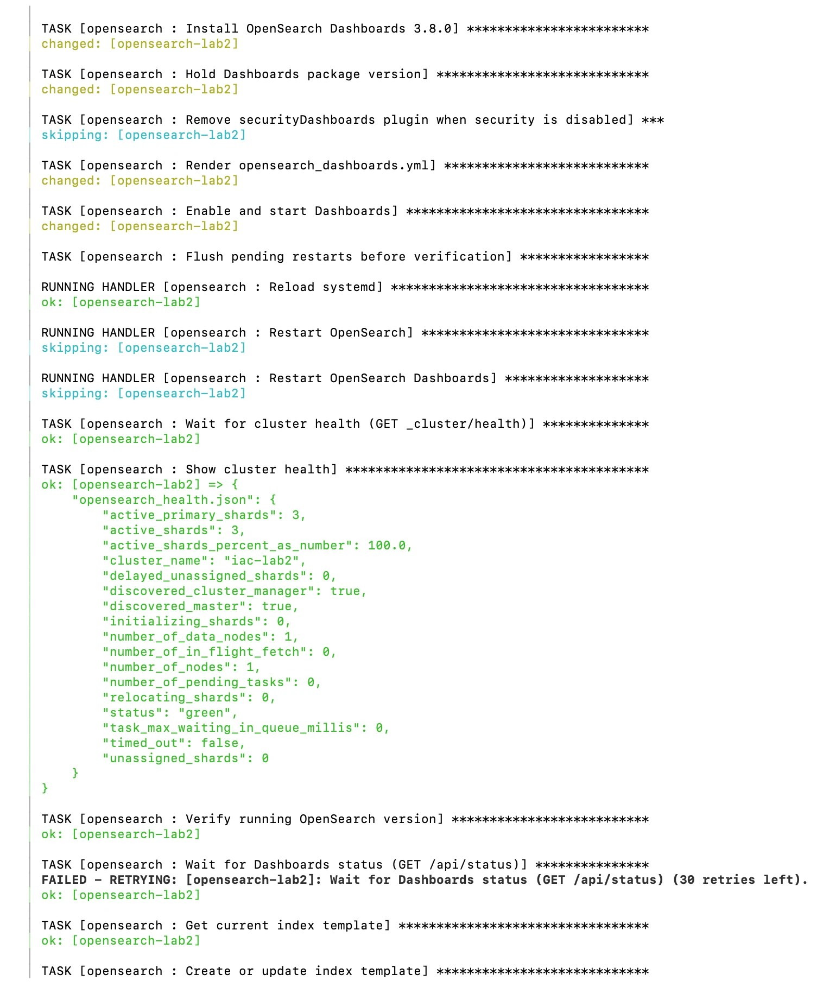

### Converge: ролевая модель

Шаблон индекса, data stream, роли, пользователи и role mapping. Пароли скрыты через `no_log`. Итог: `failed=0`.

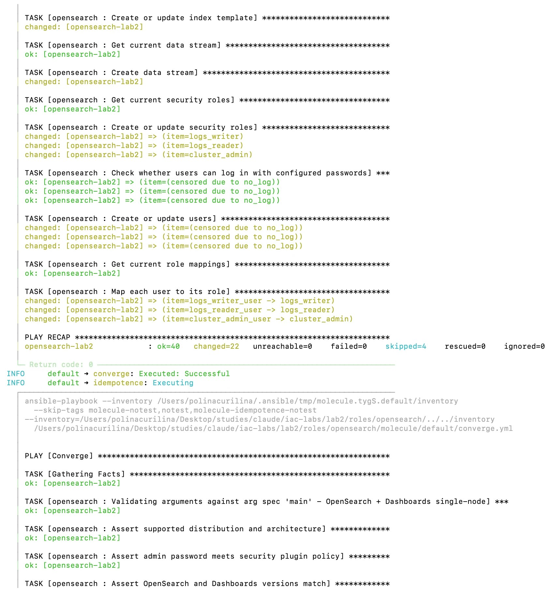

### Idempotence

Повторный прогон роли: все задачи `ok` или `skipping`, рестартов нет.

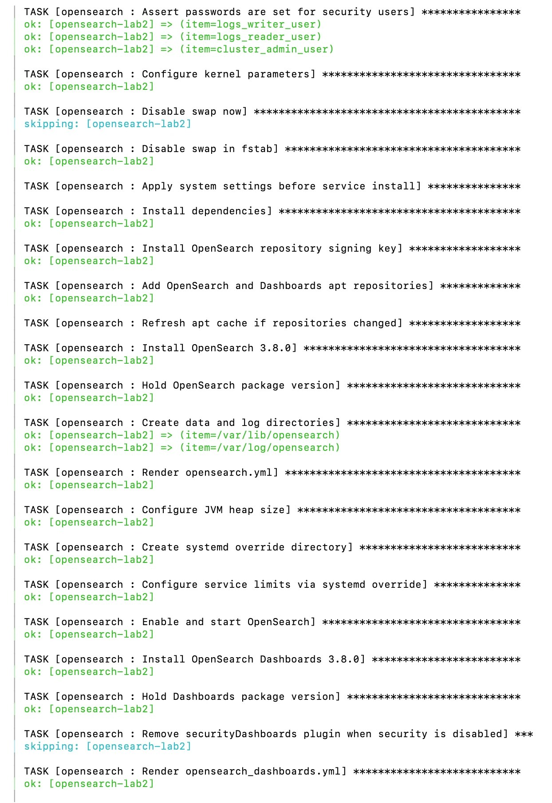

Роль прочитала текущее состояние через GET и не стала ничего менять.

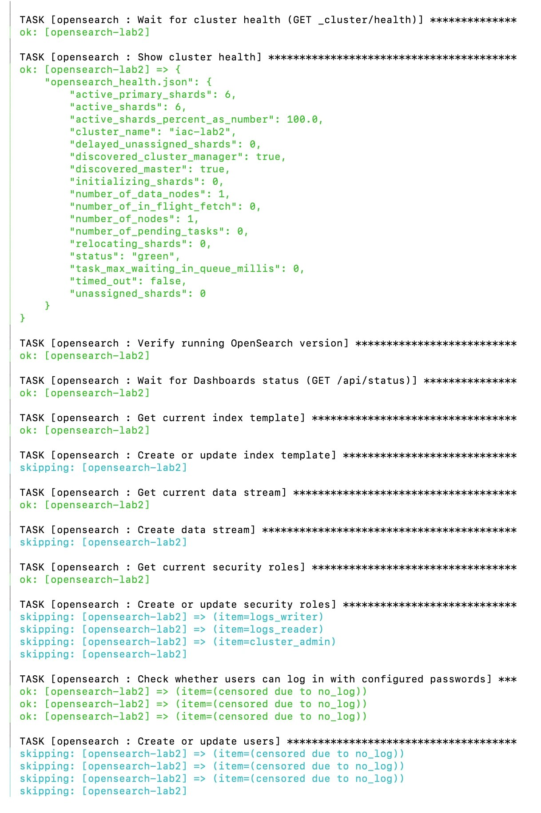

Итог повторного прогона: `changed=0`. Дальше VM перезагружается (`side_effect`) и начинается сценарий 0. `FAILED - RETRYING` здесь означает, что после перезагрузки сервисы ещё запускаются.

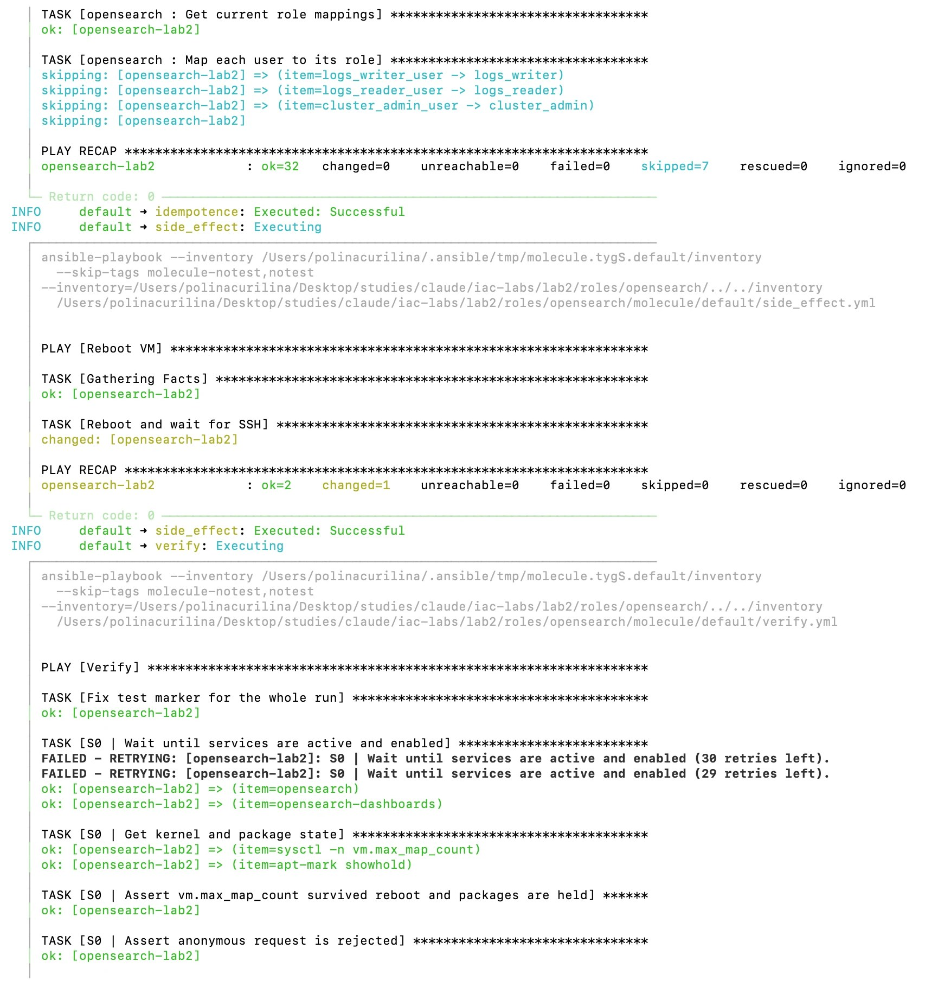

### Сценарий 0 и GET _cluster/health

Состояние кластера после перезагрузки:

```json
{
  "active_primary_shards": 6,
  "active_shards": 6,
  "active_shards_percent_as_number": 100.0,
  "cluster_name": "iac-lab2",
  "delayed_unassigned_shards": 0,
  "discovered_cluster_manager": true,
  "discovered_master": true,
  "initializing_shards": 0,
  "number_of_data_nodes": 1,
  "number_of_in_flight_fetch": 0,
  "number_of_nodes": 1,
  "number_of_pending_tasks": 0,
  "relocating_shards": 0,
  "status": "green",
  "task_max_waiting_in_queue_millis": 0,
  "timed_out": false,
  "unassigned_shards": 0
}
```

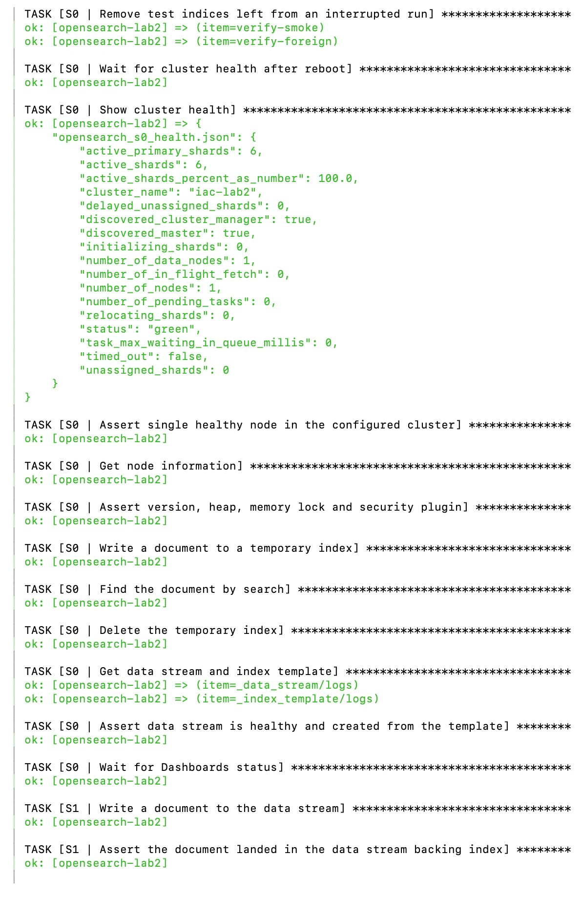

### Сценарии 1–3

Задача считается успешной, только если ответ совпал с ожидаемым. Поэтому `ok` у задач `... is forbidden` означает, что сервер действительно ответил 403.

Начало сценария 1 из того же прогона, текстом:

```
TASK [S1 | Write a document to the data stream] ********************************
ok: [opensearch-lab2]

TASK [S1 | Assert the document landed in the data stream backing index] ********
ok: [opensearch-lab2]

TASK [S1 | Assert search is forbidden] *****************************************
ok: [opensearch-lab2]

TASK [S1 | Assert reading the document by id is forbidden] *********************
ok: [opensearch-lab2]
```

Остальная часть сценария 1 и сценарии 2 и 3:

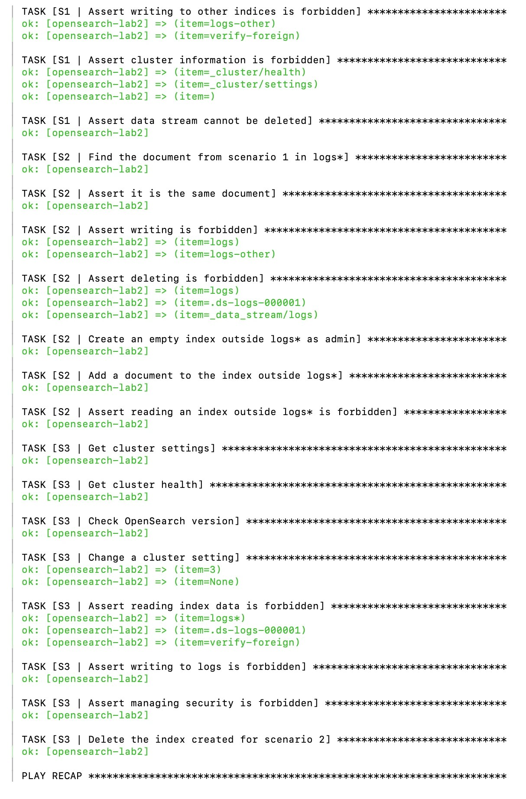

### Итог molecule test

Сценарии: `ok=40`, `changed=0`, `failed=0`. Все 8 шагов успешны: `actions=8 successful=8 failed=0`.

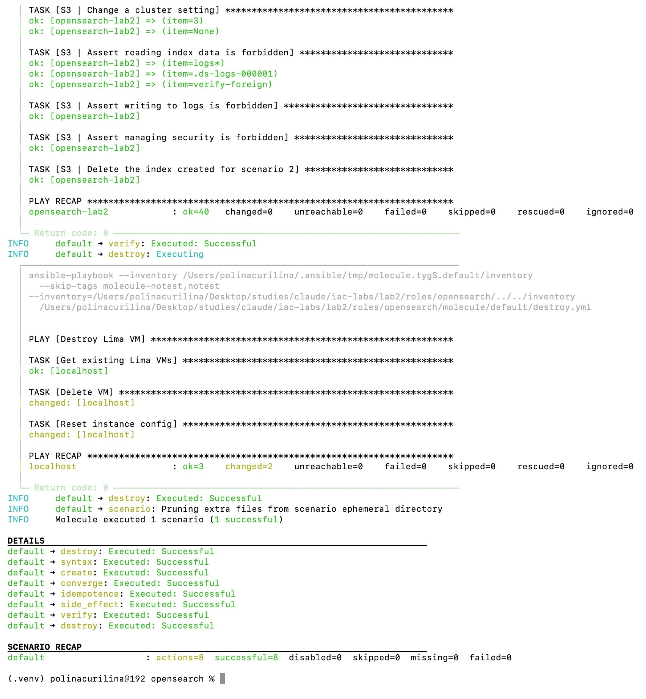

### Пароли зашифрованы

Файл `vault.yml` в репозитории выглядит так:

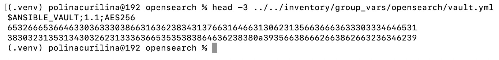

## Грабли

**Грабля 1: роли записи не хватает прав на индекс.** С правами только на `logs` запись падала с `no permissions for [indices:data/write/bulk]`. Запись одного документа внутри выполняется как bulk, а это кластерное действие, поэтому его пришлось выдать отдельно.

**Грабля 2: первая запись требует изменения маппинга.** После этого запись упала уже с `no permissions for [indices:admin/mapping/put]`: новое поле `message` меняло маппинг. Выдавать это право роли «только запись» неправильно, поэтому поля описаны в шаблоне, а `dynamic: false` запрещает их автоматическое добавление.

**Грабля 3: backing-индексы не подходят под `logs*`.** Реальный индекс data stream называется `.ds-logs-000001`, поэтому я ожидала, что роли чтения понадобится ещё и паттерн `.ds-logs-*`. Проверка показала, что `logs*` достаточно. Заодно выяснилось, что такая роль может читать и сам `.ds-logs-000001` напрямую. Это те же данные `logs`, так что границу доступа это не нарушает.

**Грабля 4: тест проверял сервис слишком рано.** Первый полный прогон упал сразу после перезагрузки: `opensearch` был в состоянии `activating`, а запуск занимает около 10 секунд. Сервис был исправен, ошибка была в тесте. Теперь тест ждёт его с ограниченным числом попыток.

**Грабля 5: тест сам портил статус кластера.** Сценарий 3 увидел `yellow`, потому что индекс из сценария 2 создавался с одной репликой, которую на одном узле негде разместить. Теперь он создаётся без реплик. Индексы, оставшиеся от прерванного прогона, удаляются в начале сценария 0.

**Грабля 6: маркер документа разбивался на два слова.** На новой VM всё проходило, но повторный `molecule verify` падал: поиск находил несколько документов. Поле `message` имеет тип `text`, поэтому маркер `molecule-1793...` разбивался на два слова и совпадал с документами прошлых прогонов. Маркер теперь без дефиса, а повторный запуск я проверила дважды.

**Грабля 7: Molecule не принял имя роли.** Он собирает полное имя из автора в `meta/main.yml`, а `Polina Churilina` под правила Galaxy не подходит. Помогло явное `namespace: churilina`.

## Выводы

- Роль создаёт три изолированные роли с минимально нужными правами, пользователей и data stream с шаблоном. Повторный прогон даёт `changed=0`.
- `molecule test` одной командой проверяет всё с нуля на новой VM, включая перезагрузку: 8 шагов, сценарии 0–3.
- Запреты проверены отдельно от разрешений: большая часть тестов ожидает именно 403.
- Пароли зашифрованы и не попадают в лог.

Ограничения, о которых стоит знать:

- TLS-сертификаты и пароль служебного пользователя `kibanaserver` по-прежнему демонстрационные, как и в первой лабе. Для стенда это допустимо, для рабочей среды нет.
- У каждого пользователя в роли ровно одна роль безопасности, и role mapping перезаписывает список пользователей этой роли.
- Ветку `opensearch_security_enabled: false` я не проверяла.

## Про инструменты

- **Molecule**: запускает полный цикл проверки роли, от создания машины до удаления. Самые полезные шаги в этой лабе: `idempotence` и `side_effect`, которым я проверила автозапуск.
- **Security REST API**: роли, пользователи и сопоставления в OpenSearch хранятся в кластере, поэтому ими можно управлять через API, без правки файлов.
- **Data stream**: один адрес для записи логов поверх автоматически создаваемых индексов `.ds-*`, удобно для данных, которые только дополняются.
- **Ansible Vault**: зашифрованные секреты можно хранить в репозитории рядом с кодом, а ключ держать отдельно.
